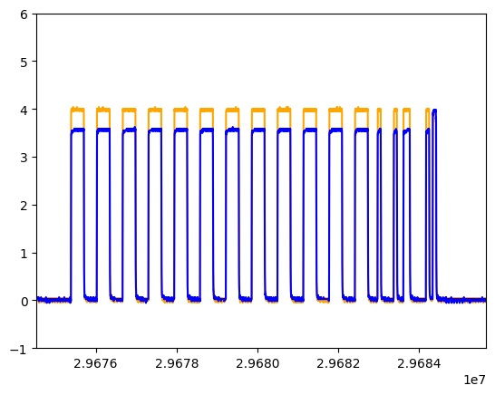

# CAN capturing with oscilloscope

This repo contains tooling to capture CAN frames and determine which side of the CAN bus these originated from with low-cost hardware.

This is done by inserting a resistor in the CAN bus, and looking at the voltage difference between probes on both side of the resistor.

On the graph below, you see the voltages on channel 1 (yellow) and channel 2 (blue) over time.
You see that the voltages difference for dominant bits are equal for the whole packet, except for the very last bit. This indicates that the last bit is sent by a different node than the rest of the bits. And indeed, the last bit is the ACK bit of the CAN frame, which is sent by every node except the node transmitting the message.

## Advantages over other solutions

Compared to `candump` passive sniffing, this solution can also recover which node on the bus sent what packet.

You can also do an active man-in-the-middle attack on a CAN bus where you cut the CAN bus wires, place a CAN transceiver on both sides, and program a microcontroller to send packets received on one side to the other side. The disadvantage is that this messes up the timings: most CAN controllers need to receive a full packet before they can process it.

## Capturing

The capturing script `capture_rnet_differential.py` is used to do a capture. At this time, the oscilloscopes supported by [OpenHantek](https://github.com/OpenHantek/OpenHantek6022) are supported (Hantek 6022BE/BL and clones).

The capture generates a .npz (Numpy compressed zipped file) that contains the raw voltages. If desired, these could also be made with another type of oscilloscope that can stream its capture data to a PC.

The instructions of how to use it can be seen by running it with `--help`.

## Decoding

The script `convert_npz.py` can decode CAN packets from the voltages in the `.npz` file. It can output to both .pcapng format, and to the plaintext format that is output when using `candump`.

The `.pcapng` format is particularly useful, since you can write a custom dissector for it. Also, we chose `.pcapng` instead of `.pcap` since with the former, you can encode more metadata (such as which side of the wire a packet originated from) and add comments on a capture file.
